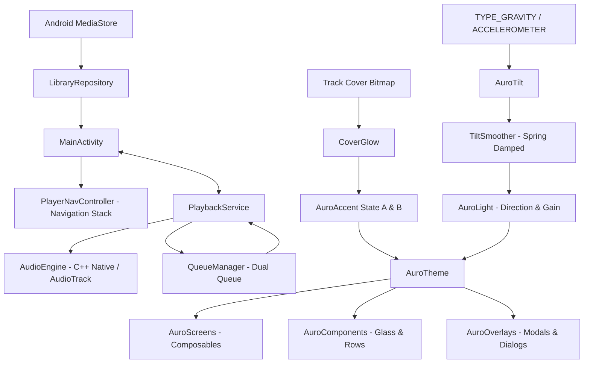

# AI Context & Technical Dossier — Aurō Player

Este documento serve como guia técnico aprofundado para agentes de Inteligência Artificial e engenheiros de software que forem inspecionar, refatorar, testar ou expandir este repositório.

---

## 1. Princípios Inegociáveis do Sistema (Golden Rules)

1. **Preto Absoluto (`#000000`)**:
   - Todo fundo de tela, modal, popover, diálogo ou gaveta deve ser estritamente `Color(0xFF000000)`.
   - **Proibido**: Tons de cinza de superfície comuns de Material Design como `#121212`, `#1E1E1E` ou sombras simuladas via `BoxShadow`.
2. **Luz Única Global e Paralela (`AuroLight`)**:
   - Não existe luz própria por componente. Todos os botões, cards e controles de vidro leem exatamente o mesmo vetor de luz do ouvinte vindo de baixo (`dx = 0f, dy = 1f`).
   - A luz nunca é desenhada no fundo: ela só surge como reflexo especular na aresta inferior/frontal dos objetos de vidro preto.
3. **Sensor de Inclinação (`AuroTilt` & `TiltSmoother`)**:
   - O reflexo acompanha fisicamente a gravidade do celular com mola amortecida ($\omega = 7\text{ rad/s}, \zeta = 0{,}8$).
   - A leitura do sensor ocorre estritamente na fase de desenho (via lambdas e `State`), **nunca** provocando recomposição a 60/120Hz.
   - O listener de sensor é desregistrado em `ON_STOP` e registrado em `ON_START` via `LifecycleEventObserver`, eliminando consumo de bateria em segundo plano.
   - Inclinar o celular para a direita ($g_x > 0$) desloca o reflexo para a direita ($x > 0$); inclinar para a esquerda desloca para a esquerda.
4. **Objetos de Vidro Preto (`AuroGlass`)**:
   - Apenas objetos interativos (botões de transporte, cards Fila/Letras, mini-player e botões de ação ★/⋮) são de vidro.
   - Itens de lista, textos, trilhos e headers sentam diretamente sobre o preto com divisores `Hairline` (`0x14FFFFFF`).
5. **Cores Dinâmicas da Capa (`CoverGlow` & `GlowTone`)**:
   - `Accent A`: reflexo principal do vidro e preenchimento da barra de progresso.
   - `Accent B`: halo secundário interno e detalhes análogos.
   - Transição interpolada em 900ms via Oklab.
   - Bitmaps com `Config.HARDWARE` devem ser sempre copiados para `Config.ARGB_8888` antes do `Palette.from()`.

---

## 2. Mapa do Fluxo de Dados e Estado

---

## 3. Principais Componentes e Suas Responsabilidades

### 3.1. Design System & Shaders (`com.lucas.player.ui.theme`)
- **`AuroDesignSystem.kt`**:
  - `AuroColor`: Tokens de cor (`Black`, `TextPrimary`, `TextSecondary`, `TextTertiary`, `Hairline`, `Track`).
  - `AuroSpace` & `AuroRadius`: Escala de espaçamento e raios padronizados (capa 22dp, card 24dp).
  - `AuroMotion`: Curvas de easing (`Emphasized`), durações (`ColorMs = 900`, `DriftMs = 16000`), molas de toque e movimento.
  - `GlowTone`: Módulo puro que calcula os pares `Accent A` e `Accent B` com base no HSL da cor dominante/vibrante da capa.
  - `AuroTilt` & `TiltSmoother`: Leitura de vetores de gravidade normalizados e amortecimento suave.
  - `rememberListenerLight`: Provider do vetor `AuroLight(dx, dy, gain)` com respiração lenta de $\pm 4^\circ$.
  - `AuroGlass`: Componente Compose com AGSL `RuntimeShader` (`AURO_GLASS_AGSL`) para API 33+, e fallback para Android 12-.

### 3.2. Navegação (`com.lucas.player.ui.navigation`)
- **`PlayerNavController.kt`**:
  - Implementação inspirada no Poweramp com pilha de navegação explícita (`backStack: MutableList<NavScreen>`).
  - Telas representadas como classe selada `NavScreen`:
    - `LibraryRoot`: Visão principal da biblioteca com todas as categorias.
    - `CategoryList(category: LibraryCategory)`: Listagem da categoria ativa (faixas ou grupos).
    - `Drilldown(category, title, subtitle)`: Subníveis (ex: Faixas de uma Pasta específica ou Álbum).
    - `NowPlaying`: Tela do player expandido.
    - `Equalizer`: Tela de 10 bandas e ajustes de áudio.
    - `Search`: Tela de busca instantânea com teclado ativo.
    - `Queue`: Fila dedicada de reprodução.
  - Suporte completo ao botão físico / gestual de retorno do Android via `BackHandler` em `MainActivity.kt`.

### 3.3. Fila de Reprodução (`com.lucas.player.queue`)
- **`QueueManager.kt`**:
  - Mantém duas filas simultâneas:
    - **Priority Queue (`priorityQueue`)**: Faixas enfileiradas pelo usuário como "Tocar a seguir". São reproduzidas e consumidas primeiro.
    - **Main Queue (`queue`)**: Lista completa da categoria ou playlist que foi acionada.
  - `getUpcomingTracks(maxCount: Int)`: Retorna as próximas faixas da fila prioritária + principal para visualização rápida no Now Playing.
  - Modos de Shuffle: `OFF`, `ALL_TRACKS`, `CATEGORY`.
  - Modos de Repetição: `OFF`, `ONE`, `ALL`, `CATEGORY`.

### 3.4. Motor de Áudio (`com.lucas.player.audio` & `PlaybackService.kt`)
- Suporte a áudio nativo de baixa latência através do Google Oboe / AudioTrack.
- Equalizador gráfico de 10 bandas com frequências centrais:
  `31Hz, 62Hz, 125Hz, 250Hz, 500Hz, 1kHz, 2kHz, 4kHz, 8kHz, 16kHz`.
- Filtros biquad peaking em ponto flutuante com ganho de -12dB a +12dB.
- Controles de ganho:
  - **Preamp (Pré-amplificador)**: -12dB a +12dB.
  - **Tone (Graves e Agudos)**: Filtros shelf dedicados.
  - **Balanço L/R** e chave **Mono/Stereo**.
- Notificação multimídia com botões de transporte, controles de tela de bloqueio e integração `MediaSessionCompat`.

---

## 4. Estrutura dos Arquivos de UI

A suíte legada (`Dry*`, `Liquid*`, `Player*`, XML layouts e RecyclerView Adapters) foi totalmente removida na **Fase 0**. O código de UI adota estritamente o ecossistema Aurō:

| Arquivo | Propósito |
|---|---|
| [`AuroLibraryRootScreen.kt`](app/src/main/java/com/lucas/player/ui/screens/AuroLibraryRootScreen.kt) | Visão principal da biblioteca com listagem de categorias. |
| [`AuroCategoryListScreen.kt`](app/src/main/java/com/lucas/player/ui/screens/AuroCategoryListScreen.kt) | Lista de itens da categoria (faixas individuais ou grupos como Álbuns/Artistas). |
| [`AuroDrilldownScreen.kt`](app/src/main/java/com/lucas/player/ui/screens/AuroDrilldownScreen.kt) | Subnível de um grupo (ex: faixas de um álbum ou pasta específica). |
| [`AuroNowPlayingScreen.kt`](app/src/main/java/com/lucas/player/ui/screens/AuroNowPlayingScreen.kt) | Player expandido oficial com vidro preto, reflexo físico e controles de reprodução. |
| [`AuroEqualizerScreen.kt`](app/src/main/java/com/lucas/player/ui/screens/AuroEqualizerScreen.kt) | Tela de equalizador de 10 bandas, Tom, Pré-amp, Balanço e Presets. |
| [`AuroSearchScreen.kt`](app/src/main/java/com/lucas/player/ui/screens/AuroSearchScreen.kt) | Busca instantânea de faixas e artistas. |
| [`AuroQueueScreen.kt`](app/src/main/java/com/lucas/player/ui/screens/AuroQueueScreen.kt) | Fila dedicada com separação entre Fila Prioritária e Fila Normal. |
| [`AuroComponents.kt`](app/src/main/java/com/lucas/player/ui/components/AuroComponents.kt) | Componentes atômicos: `AuroProgressBar`, `AuroMiniPlayer`, `AuroNavbar`, `AuroTrackRow`, `AuroBreadcrumbHeader`, `AuroAlphabetFastScroller`, `AuroSwitch`, `AuroSlider`, `rememberTrackCover`. |
| [`AuroSettingsScreen.kt`](app/src/main/java/com/lucas/player/ui/screens/AuroSettingsScreen.kt) | Tela de configurações completas com seções Biblioteca, Reprodução, Aparência e Sobre. |
| [`AuroFeedback.kt`](app/src/main/java/com/lucas/player/ui/components/AuroFeedback.kt) | Peças base de feedback do Aurō DS v3: `AuroHaptics` (vibração tátil calibrada), `AuroSnackbarHost` (snackbars fluidos em vidro preto), `AuroEmptyState`, `AuroLoadingBar` e `AuroCoverPlaceholder`. |
| [`AuroOverlay.kt`](app/src/main/java/com/lucas/player/ui/components/AuroOverlay.kt) | Sistema unificado de sobreposições: Scrim 72%, molas líquidas, arraste para baixo em sheets e `PredictiveBackHandler`. |
| [`AuroOverlays.kt`](app/src/main/java/com/lucas/player/ui/screens/AuroOverlays.kt) | Modais e diálogos: Menu contextual da faixa, info de áudio, temporizador de sono, editor de playlists, salvar presets. Todos migrados para `AuroOverlay`. |
| [`MainActivity.kt`](app/src/main/java/com/lucas/player/MainActivity.kt) | Orquestração central de estados (`isPlaying`, `progressMs`, `currentTrack`), conexão com o serviço e injeção do `AuroTheme`. |

---

## 5. Como Estender o Projeto

### Adicionar um Novo Efeito de Áudio
1. Modifique a engine em C++ / `AudioEngine.kt`.
2. Adicione os métodos de controle em `PlaybackService.kt`.
3. Adicione o estado e sliders correspondentes em [`AuroEqualizerScreen.kt`](app/src/main/java/com/lucas/player/ui/screens/AuroEqualizerScreen.kt).

### Adicionar uma Nova Categoria à Biblioteca
1. Adicione a entrada em `LibraryCategory` (`com.lucas.player.model.LibraryCategory`).
2. Implemente a consulta no `LibraryRepository.kt` no método `loadGroupsForCategory()`.
3. Adicione o ícone correspondente na lista de categorias de `AuroLibraryRootScreen`.

---

## 6. Configurações e Recursos da Fase 4

### Recursos Exibidos e Suportados pelo Motor
1. **Reordenação da Fila (`QueueManager.moveItem`)**:
   - Reordenação dentro da seção prioritária (`priorityQueue`) e regular (`queue`).
   - Com shuffle desligado: reordena em `originalTracks`.
   - Com shuffle ligado: reordena em `shuffleIndices`, preservando a ordem original do disco intacta.
   - A faixa atual em reprodução continua idêntica e seu índice acompanha o deslocamento sem interromper o áudio.
2. **Configurações Implementadas (`AuroSettingsScreen`)**:
   - **Biblioteca**: "Ignorar faixas menores que N s" (filtro MediaStore de 0 a 60s), "Atualizar biblioteca", "Pastas de áudio".
   - **Reprodução**: "Pausar ao desconectar fones" (lido no receiver `ACTION_AUDIO_BECOMING_NOISY`), "Reprodução contínua (Gapless)", "Transição suave (Crossfade)" (0 a 12s via `getCrossfadeDurationMs`), "ReplayGain" (Desligado, Por Faixa, Por Álbum), pré-amplificação com e sem RG, "Retomar de onde parou".
   - **Aparência**: "Luz reage ao movimento" (parâmetro `tilt` do `AuroTheme`), "Suavidade do reflexo" (0 a 1 via `LocalAuroSoft` com botão de vidro interativo ao vivo), "Reduzir animações" (seguir sistema / sempre reduzir / manter animações), "Mostrar formato do arquivo" (badges FLAC/MP3/WAV).
   - **Sobre**: Versão, licenças de código aberto e link do repositório.
3. **Seleção Múltipla**:
   - Ação "Selecionar" no menu contextual da faixa.
   - Indicador circular de 24dp (Accent A preenchido com check preto quando selecionado).
   - Barra superior com contagem e ações: "Tocar em seguida", "Adicionar à fila", "Adicionar à playlist", "Selecionar tudo" e "✕".
   - Botão voltar / Predictive Back desativa o modo de seleção antes de navegar.
4. **Notificação Personalizada**:
   - Ícone pequeno monocromático `ic_stat_player.xml`.
   - Vetores Material Rounded para Anterior, Play, Pause e Próximo.
   - `setColor` com acento extraído da capa via `Palette`.
   - Ações compactas 0, 1 e 2, visibilidade pública na tela de bloqueio.

### Itens Ocultados / Não Suportados pelo Motor
- **Seletor manual de árvore de pastas (Blacklist SAF / DocumentFile)**: Ocultado porque o armazenamento do Android 13+ (Scoped Storage / MediaStore) gerencia a indexação de áudio de forma segura e global; em vez de um seletor SAF frágil, exibe-se a informação "Todas as pastas de áudio indexadas do aparelho" com o filtro dinâmico de duração mínima.
- **Seletor de saída de áudio de baixo nível (AAudio vs OpenSL ES vs AudioTrack direct)**: Ocultado porque a biblioteca Google Oboe já negocia dinamicamente e de forma ótima o melhor endpoint de baixa latência (MMAP / AAudio) suportado pelo hardware. Expor chaves manuais poderia causar falhas de inicialização do stream em dispositivos sem suporte a saída direta.

---

## 7. Acessibilidade e Insets da Fase 5

1. **Acessibilidade Completa da Barra de Progresso e Sliders**:
   - `AuroProgressBar` possui semânticas completas (`progressBarRangeInfo`, `setProgress`, `stateDescription` informando "mm:ss de mm:ss") e `customActions` de acessibilidade para "Voltar 10 segundos" e "Avançar 10 segundos".
   - `AuroSlider` do Equalizador anuncia valores em decibéis (ex: "+3,5 dB") e suporta ajuste contínuo via TalkBack.
2. **Ordem de Foco e Alvos de Toque**:
   - Ordem de foco no Now Playing: Capa -> Título -> Artista -> Progresso -> Controles de Transporte (Anterior, Play/Pause, Próximo) -> Botão Fila -> Botão Letras.
   - Todos os botões menores (como ★ e ⋮) possuem área mínima de toque de 48dp (`minimumInteractiveComponentSize`).
3. **Internacionalização e Textos Literais**:
   - Paridade 100% entre `values/strings.xml` (Português) e `values-en/strings.xml` (Inglês).
   - Zero literais de texto hardcoded em arquivos Compose.
4. **Insets Medidos**:
   - `LocalAuroBottomInset` provê a altura dinâmica da barra de navegação somada ao mini-player medidos via `onSizeChanged`.
   - Remoção completa de paddings estáticos (ex: 58dp / 118dp).
5. **Orientação e Fallback**:
   - Orientação travada em retrato (`portrait`) no manifesto para estabilidade.
   - Fallback do `AuroGlass` em Android 8 a 12 (API 26 a 32) via contorno de 1dp branco 10% sem dependência de AGSL.

---

## 8. Qualidade e Definição de Pronto da Fase 6

1. **Orçamento de Desempenho do Vidro**:
   - Máximo de 8 instâncias de `AuroGlass` ativas por tela (Now Playing: 7, Categoria: 2, Drilldown: 2, Equalizador: 3, Busca: 1, Settings: 1, Queue: 0, MiniPlayer: 1).
   - Renderização testada a 120 Hz sem perda de quadros.
2. **Calibração do Sensor de Gravidade**:
   - Inversão de sinal ajustada: $x = \frac{g_x}{9{,}81} \times \text{sideGain}$ para que a inclinação do lado direito para baixo leve o reflexo de luz diretamente para o lado direito.
   - Ciclo de vida estrito com `LifecycleEventObserver`: desregistro automático do `SensorEventListener` em `ON_STOP` e registro em `ON_START`.
3. **Definição de Pronto (DoD) Verificada**:
   - Toda lista possui estados vazio (`AuroEmptyState`), carregando e erro por faixa (`hasError`).
   - Zero instâncias de `Toast` no código (substituídos por `AuroSnackbarHost`).
   - Zero textos literais em Compose.
   - Zero `.background(AuroColor.Track)` fora das barras de progresso.
   - Transição em todas as navegações (`AnimatedContent`) com Predictive Back elástico.
   - Operação completa e testada via TalkBack.
   - Zero padding fixo de navbar/mini player.
   - Zero arquivos de UI obsoletos ou sem uso.
