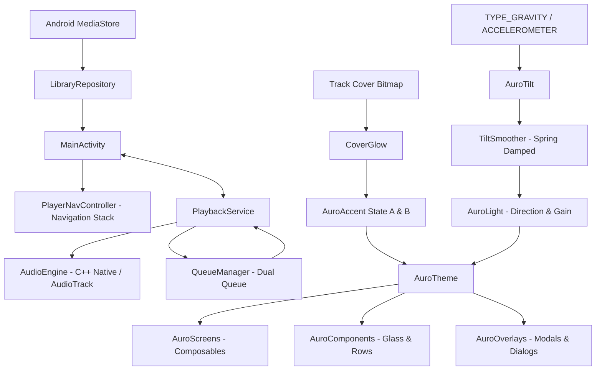

# AI Context & Technical Dossier — Aurō Player

Este documento serve como guia técnico aprofundado para agentes de Inteligência Artificial e engenheiros de software que forem inspecionar, refatorar, testar ou expandir este repositório.

---

## 1. Princípios Inegociáveis do Sistema (Golden Rules)

1. **Preto Absoluto (`#000000`)**:
   - Todo fundo de tela, modal, popover, diálogo ou gaveta deve ser estritamente `Color(0xFF000000)`.
   - **Proibido**: Tons de cinza de superfície comuns de Material Design como `#121212`, `#1E1E1E` ou sombras simuladas via `BoxShadow`.
2. **Luz Única Global e Paralela (`AuroLight`)**:
   - Não existe luz própria por componente. Todos os botões, cards e controles de vidro leem exatamente o mesmo vetor de luz do ouvinte vindo de baixo (`dx = 0f, dy = 1f`).
   - A luz nunca é desenhada no fundo: ela só surge como reflexo especular na aresta inferior/frontal dos objetos de vidro preto.
3. **Sensor de Inclinação (`AuroTilt` & `TiltSmoother`)**:
   - O reflexo acompanha fisicamente a gravidade do celular com mola amortecida ($\omega = 7\text{ rad/s}, \zeta = 0{,}8$).
   - A leitura do sensor deve ocorrer estritamente na fase de desenho (via lambdas e `State`), **nunca** provocando recomposição a 60/120Hz.
4. **Objetos de Vidro Preto (`AuroGlass`)**:
   - Apenas objetos interativos (botões de transporte, cards Fila/Letras, mini-player e botões de ação ★/⋮) são de vidro.
   - Itens de lista, textos, trilhos e headers sentam diretamente sobre o preto com divisores `Hairline` (`0x14FFFFFF`).
5. **Cores Dinâmicas da Capa (`CoverGlow` & `GlowTone`)**:
   - `Accent A`: reflexo principal do vidro e preenchimento da barra de progresso.
   - `Accent B`: halo secundário interno e detalhes análogos.
   - Transição interpolada em 900ms via Oklab.
   - Bitmaps com `Config.HARDWARE` devem ser sempre copiados para `Config.ARGB_8888` antes do `Palette.from()`.

---

## 2. Mapa do Fluxo de Dados e Estado

---

## 3. Principais Componentes e Suas Responsabilidades

### 3.1. Design System & Shaders (`com.lucas.player.ui.theme`)
- **`AuroDesignSystem.kt`**:
  - `AuroColor`: Tokens de cor (`Black`, `TextPrimary`, `TextSecondary`, `TextTertiary`, `Hairline`, `Track`).
  - `AuroSpace` & `AuroRadius`: Escala de espaçamento e raios padronizados (capa 22dp, card 24dp).
  - `AuroMotion`: Curvas de easing (`Emphasized`), durações (`ColorMs = 900`, `DriftMs = 16000`), molas de toque e movimento.
  - `GlowTone`: Módulo puro que calcula os pares `Accent A` e `Accent B` com base no HSL da cor dominante/vibrante da capa.
  - `AuroTilt` & `TiltSmoother`: Leitura de vetores de gravidade normalizados e amortecimento suave.
  - `rememberListenerLight`: Provider do vetor `AuroLight(dx, dy, gain)` com respiração lenta de $\pm 4^\circ$.
  - `AuroGlass`: Componente Compose com AGSL `RuntimeShader` (`AURO_GLASS_AGSL`) para API 33+, e fallback para Android 12-.

### 3.2. Navegação (`com.lucas.player.ui.navigation`)
- **`PlayerNavController.kt`**:
  - Implementação inspirada no Poweramp com pilha de navegação explícita (`backStack: MutableList<NavScreen>`).
  - Telas representadas como classe selada `NavScreen`:
    - `LibraryRoot`: Visão principal da biblioteca com todas as categorias.
    - `CategoryList(category: LibraryCategory)`: Listagem da categoria ativa (faixas ou grupos).
    - `Drilldown(category, title, subtitle)`: Subníveis (ex: Faixas de uma Pasta específica ou Álbum).
    - `NowPlaying`: Tela do player expandido.
    - `Equalizer`: Tela de 10 bandas e ajustes de áudio.
    - `Search`: Tela de busca instantânea com teclado ativo.
    - `Queue`: Fila dedicada de reprodução.
  - Suporte completo ao botão físico / gestual de retorno do Android via `BackHandler` em `MainActivity.kt`.

### 3.3. Fila de Reprodução (`com.lucas.player.queue`)
- **`QueueManager.kt`**:
  - Mantém duas filas simultâneas:
    - **Priority Queue (`priorityQueue`)**: Faixas enfileiradas pelo usuário como "Tocar a seguir". São reproduzidas e consumidas primeiro.
    - **Main Queue (`queue`)**: Lista completa da categoria ou playlist que foi acionada.
  - `getUpcomingTracks(maxCount: Int)`: Retorna as próximas faixas da fila prioritária + principal para visualização rápida no Now Playing.
  - Modos de Shuffle: `OFF`, `ALL_TRACKS`, `CATEGORY`.
  - Modos de Repetição: `OFF`, `ONE`, `ALL`, `CATEGORY`.

### 3.4. Motor de Áudio (`com.lucas.player.audio` & `PlaybackService.kt`)
- Suporte a áudio nativo de baixa latência através do Google Oboe / AudioTrack.
- Equalizador gráfico de 10 bandas com frequências centrais:
  `31Hz, 62Hz, 125Hz, 250Hz, 500Hz, 1kHz, 2kHz, 4kHz, 8kHz, 16kHz`.
- Filtros biquad peaking em ponto flutuante com ganho de -12dB a +12dB.
- Controles de ganho:
  - **Preamp (Pré-amplificador)**: -12dB a +12dB.
  - **Tone (Graves e Agudos)**: Filtros shelf dedicados.
  - **Balanço L/R** e chave **Mono/Stereo**.
- Notificação multimídia com botões de transporte, controles de tela de bloqueio e integração `MediaSessionCompat`.

---

## 4. Estrutura dos Arquivos de UI

| Arquivo | Propósito |
|---|---|
| [`AuroScreens.kt`](app/src/main/java/com/lucas/player/ui/screens/AuroScreens.kt) | Contém as telas oficiais em Compose: `AuroNowPlayingScreen`, `AuroLibraryRootScreen`, `AuroCategoryListScreen`, `AuroDrilldownScreen`, `AuroEqualizerScreen`, `AuroSearchScreen`, `AuroQueueScreen`. |
| [`AuroComponents.kt`](app/src/main/java/com/lucas/player/ui/components/AuroComponents.kt) | Componentes atômicos: `AuroProgressBar`, `AuroMiniPlayer`, `AuroNavbar`, `AuroTrackRow`, `AuroBreadcrumbHeader`, `AuroAlphabetFastScroller`, `AuroRatingBar`. |
| [`AuroOverlays.kt`](app/src/main/java/com/lucas/player/ui/screens/AuroOverlays.kt) | Modais e diálogos: Menu de contexto da faixa, informações de áudio, temporizador de sono, editor de playlists, salvar presets. |
| [`MainActivity.kt`](app/src/main/java/com/lucas/player/MainActivity.kt) | Orquestração central de estados (`isPlaying`, `progressMs`, `currentTrack`), conexão com o serviço e injeção do `AuroTheme`. |

---

## 5. Como Estender o Projeto

### Adicionar um Novo Efeito de Áudio
1. Modifique a engine em C++ / `AudioEngine.kt`.
2. Adicione os métodos de controle em `PlaybackService.kt`.
3. Adicione o estado e sliders correspondentes em `AuroEqualizerScreen` em [`AuroScreens.kt`](app/src/main/java/com/lucas/player/ui/screens/AuroScreens.kt).

### Adicionar uma Nova Categoria à Biblioteca
1. Adicione a entrada em `LibraryCategory` (`com.lucas.player.model.LibraryCategory`).
2. Implemente a consulta no `LibraryRepository.kt` no método `loadGroupsForCategory()`.
3. Adicione o ícone correspondente na lista de categorias de `AuroLibraryRootScreen`.
